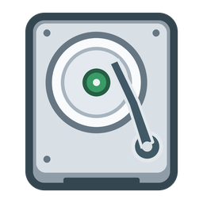

# hdd-noise · 机械硬盘声音模拟器

[](https://github.com/bcosn/hdd-noise/actions/workflows/build.yml)
[](LICENSE)

给过于安静的 SSD 补上机械硬盘的声音。Windows 原生 C++17 程序，使用系统默认窗口、字体和控件；声音由代码实时合成，无录音循环、素材包或第三方音频运行库。

<p align="center"></p>

## 使用

在 [Actions](https://github.com/bcosn/hdd-noise/actions/workflows/build.yml) 中打开成功的构建，下载 Artifacts 内的便携 ZIP。外层 Actions 压缩包中包含实际分发 ZIP 和校验文件。解压实际分发 ZIP 后运行 **hdd-noise.exe**。也可从源码编译，产物位于 `out/`。支持 Windows 10/11 x64，无需管理员权限。

启动后播放约 3 秒的加速声，随后待机旋转，并根据所选磁盘的真实活动发出寻道声。关闭窗口或选择“停转并退出”时，播放约 2.4 秒的减速声后退出。强制结束进程无法播放退出音效。

| 控件 | 用途 |
| --- | --- |
| 监测磁盘 | 所有物理磁盘或单盘；显示活动时间百分比、每秒 I/O 次数及吞吐量 |
| 硬盘预设 | WD1600JD 参考、日立 T7K500 参考、笔记本 2.5 寸 5400 / 7200 RPM |
| 转速 | 3600～15000 RPM；控制旋转基频和电机谐波音高 |
| 通透度 | 减少低频和低中频遮盖，保留细节与瞬态；默认 65% |
| 各声部音量 | 总音量、电机、寻道、撞击、脉冲分别调节 |
| 脉冲声 | 默认关闭；每次约 9 ms 的短脉冲，重复频率 2～40 Hz，默认 8 Hz，中间有安静间隔 |
| 随机撞击 | 可关闭；实际间隔在所设平均间隔的 0.5～1.5 倍之间浮动 |
| 试听 | 无需制造磁盘负载即可试听约 0.3 秒寻道声或一次撞击 |

选择预设时会同时恢复它的默认转速（笔记本 5400 为 5400 RPM，其余为 7200 RPM），之后仍可单独修改转速。笔记本预设使用较轻的执行器、较短的动作与不同的机壳共振，不只是降低转速。预设是合成音色设计，具体参考和局限见 [声音设计](SOUND-DESIGN.md)。

设置自动保存到 exe 同目录的 `hdd-noise.ini`。将程序放在可写文件夹中即可保持便携。重复启动只唤起已有窗口；更新前先退出旧实例。

## 托盘

- “收进托盘”或最小化后在后台继续发声；单击、双击或键盘选择硬盘图标可恢复窗口。
- 右键菜单提供启停、静音、脉冲开关、四种预设、试听和退出。
- 悬停提示显示状态、转速和磁盘活动；Explorer 重启后自动重新注册。
- 图标有多种尺寸，随窗口 DPI 更新；Windows 可能将新图标放入托盘折叠区域。
- 注册失败时保持窗口可用并重试，不会把唯一控制窗口永久藏起来。便携程序移动位置导致 GUID 注册失败时，使用窗口标识作为兼容方式。

### 提示“托盘暂不可用”或“受限运行状态”

有些受限开发环境会给目录和新生成的 EXE 继承低完整性标签。Windows 会按 EXE 自身与启动者两者中较低的完整性级别创建进程，因此从资源管理器双击也可能受限，不能向正常桌面的 Explorer 注册托盘。这不是缺少管理员权限，也不需要关闭 UAC。原理见 [Microsoft 的完整性控制说明](https://learn.microsoft.com/en-us/windows/win32/secauthz/mandatory-integrity-control)。

优先将 GitHub 构建包解压到普通用户文件夹后运行。本地构建遇到这种情况时，退出旧程序，在普通桌面 PowerShell 中运行：

```powershell
./scripts/prepare-desktop.ps1 -Executable ./out/hdd-noise.exe
# 如果使用根目录的副本，改为 -Executable ./hdd-noise.exe
```

若 PowerShell 的脚本策略禁止运行脚本，可在普通终端只对这个 EXE 执行 `icacls .\hdd-noise.exe /setintegritylevel M`，无需更改脚本策略。

此脚本只给指定的本项目 EXE 设置普通桌面运行标签，不修改文件内容、目录权限、UAC 或系统信任设置。不要对整个项目目录递归修改权限。已启动的受限进程不会因此改变身份，需要退出后重新运行。

导出实际运行程序的托盘诊断（无声音）：

```powershell
./out/hdd-noise.exe --diagnose-tray ./tray-diagnostic.txt
```

诊断中的 `trayAdded=1` 表示真实注册成功，`version4=1` 表示已启用新版回调；`processIntegrity=4096` 表示低完整性，通常的桌面进程为 8192 或更高。注册失败时窗口保留可用，状态栏给出原因并自动重试。

图标为本项目原创，SVG、PNG 和多尺寸 ICO 位于 `assets/`。`tools/generate_icon.py` 可用 Pillow 重新生成 ICO/PNG；正常编译和运行无需 Python。

## 声音如何生成

| 类型 | 声源 |
| --- | --- |
| 启动 / 停转 | 相位连续的旋转基波和多次谐波，随转速平滑升降；断电后电磁成分先退去，盘片继续惯性减速 |
| 待机旋转 | 带限噪声激励盘体响应，叠加弱旋转基频、电机阶次和轴承气流 |
| 忙碌寻道 | 磁盘活动时间及 I/O 次数驱动分组的磁头加减速激励，经过固定机壳响应 |
| 随机撞击 | 亚毫秒接触与较弱回弹，激励独立的非整数倍金属共振，形成短促咔嗒声 |
| 可选脉冲 | 独立短包络与载波；不是持续的电流滋声，也不作为品牌区别依据 |

正常音量下保留线性输出，仅大峰值进入软限幅，避免持续饱和把细节压闷。程序不会主动读写磁盘制造声音；监测的是活动时间，不是存储空间占用率。PDH 每 250 ms 采样一次，兼容中文系统，磁盘断开和计数器故障时会重试。音频输出为 48 kHz、双声道 16-bit，四块缓冲合计约 40 ms。

## 编译和测试

安装 Visual Studio / Build Tools 的 C++ 桌面开发组件及 Windows SDK。在项目根目录运行：

```bat
build.bat
build.bat test
```

脚本自动定位 MSVC，也支持 PATH 中的 MinGW-w64。EXE 静态链接 C++ 运行库。也支持 CMake：

```bat
cmake -S . -B build/cmake -A x64 -DBUILD_TESTING=ON
cmake --build build/cmake --config Release --parallel
ctest --test-dir build/cmake -C Release --output-on-failure
```

合成测试覆盖启停、反转、频谱与转速关系、负载响应、四个预设、脉冲节奏与静默间隔、通透度、撞击频带与衰减、极限混音和异常参数。

`build.bat integration` 会对真实音频设备进行静音测试。CMake 另提供 `HDD_AUDIO_INTEGRATION_TESTS=ON` 和 `HDD_DESKTOP_INTEGRATION_TESTS=ON`：后者检查原生控件、图标 DPI、真实托盘注册和 Explorer 重建消息，不播放声音。没有音频设备、交互桌面或进程完整性级别过低时，相关环境测试返回 77，CTest 显示跳过；不能将跳过当成托盘实测通过。CI 默认只运行无需设备的合成测试。

## 离线导出

```bat
out\hdd-noise.exe --render-demo out\hdd-noise-WD.wav wd
out\hdd-noise.exe --render-demo out\hdd-noise-Hitachi.wav hitachi
out\hdd-noise.exe --render-demo out\hdd-noise-Laptop5400.wav laptop5400
out\hdd-noise.exe --render-demo out\hdd-noise-Laptop7200.wav laptop7200
out\hdd-noise.exe --render-demo out\hdd-noise-Pulse.wav pulse
out\hdd-noise.exe --render-demo out\hdd-noise-Impact.wav impact
out\hdd-noise.exe --diagnose-monitor out\monitor-diagnostic.txt
out\hdd-noise.exe --tray
```

导出使用与实时播放相同的合成器，无需音频设备。18 秒普通示范为：0～3 秒加速，6～11 秒密集寻道，11 秒撞击，13 秒寻道试听，15 秒开始停转。`pulse` 只保留脉冲，`impact` 只保留撞击。日常运行不读取这些 WAV。自动化调用 GUI 程序时，应等待进程退出后再读取导出文件。

## 源码与发布

- `App.cpp`：原生窗口、设置、托盘和导出入口。
- `Synth.h / Synth.cpp`：无动态分配的逐采样合成器，可独立移植。
- `AudioEngine.*`：Windows waveOut 输出与线程控制。
- `DiskMonitor.*`：独立线程读取 PDH 磁盘活动。
- `tests/`：声音、真实音频设备、原生控件和托盘测试。

窗口、托盘和便携设置结构参考了本机 movingback 项目的思路；声音合成器为本项目实现。

GitHub 工作流编译、测试并生成便携 ZIP、SHA-256 和默认分支的构建来源证明。详见 [发布说明](docs/RELEASING.md)。正式 Windows 发布者签名的脚本已接入，见 [签名说明](docs/SIGNING.md)；尚未配置正式证书，当前 EXE 为未签名构建。GitHub 来源证明不会改变 Windows 签名状态。

代码和原创图标以 [MIT License](LICENSE) 开源。WD / Western Digital、Hitachi 等名称仅用于说明参考来源，本项目与这些厂商无隶属关系。
